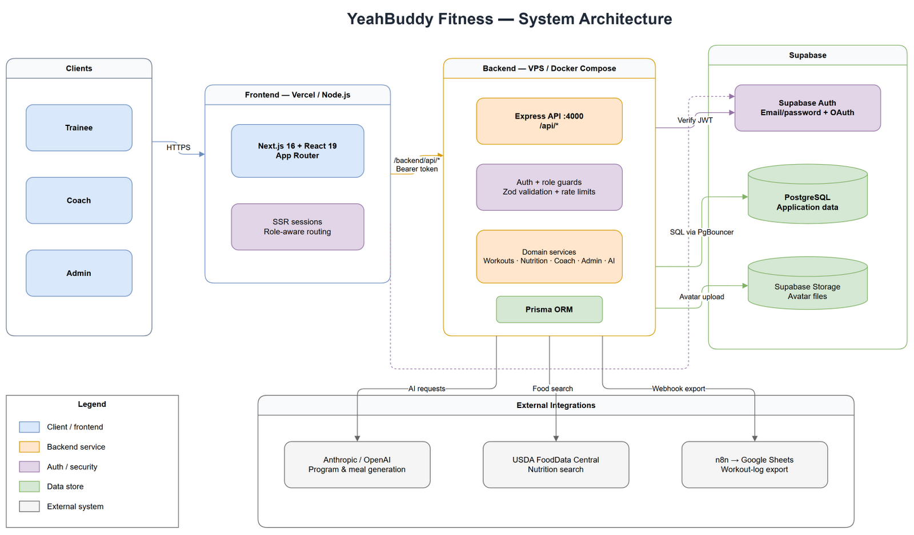

<p align="center">
  
</p>

<h1 align="center">YeahBuddy Fitness</h1>

<p align="center">
  A full-stack coaching platform where personal trainers build programs and clients log every set, meal and check-in.
  <br />
  <a href="https://www.hominhduc.me"><strong>Live demo »</strong></a>
</p>

<p align="center">
  
  
  
  
  
  
</p>

---

## Overview

YeahBuddy started as a workout logger and grew into a platform for small coaching businesses. It serves three roles, each with its own workspace:

- **Trainees** follow the program their coach assigned, log sets in a focused session screen, track meals, weight and recovery, and see their progress over time.
- **Coaches** build multi-week programs, assign and adjust them per client, review logs and check-ins, and leave feedback on individual sessions.
- **Admins** manage users, approve coach sign-ups, curate the shared exercise and food libraries, and read audit logs.

The whole interface is available in Vietnamese and English and installs as a PWA on phones.

### At a glance

| | |
|---|---|
| **Scope** | 28 pages, 14 API route modules, 38 database models, 60 migrations |
| **Codebase** | ~110k lines of TypeScript across a Next.js frontend and an Express backend |
| **Tests** | 150+ test files, ~1,300 tests (Vitest + Testing Library) |
| **History** | ~980 commits since December 2025, Conventional Commits, PR-based workflow with CI |

---

## Features

### Training
- Session screen built for the gym floor: set-by-set logging of weight, reps and RIR, previous-performance hints, rest timer, and drafts saved on the server so a session survives a closed tab or a dead phone battery.
- Multi-week program editor with drag-and-drop day slots, week copy/paste, reusable routines and per-set targets (rep ranges, RIR, intensity techniques such as drop sets, rest-pause and myo-reps).
- Weekly schedule that slides missed sessions forward instead of marking them failed.
- Volume and recovery analysis per muscle group, combining logged volume, soreness check-ins and wearable data to suggest when to add or cut sets.

### Coaching
- Coach dashboard with recent logs, compliance and per-client status.
- Per-client program adjustments without changing the shared template.
- Two-way Google Sheets integration: import a program from a sheet and export client logs back to it.
- Coach discovery and connection requests between trainees and coaches.

### Nutrition and body metrics
- Meal logging against a food database with calories and macros.
- Weight log, body measurements and progress charts.
- Huawei Health sync for sleep, heart rate and weight.

### AI assistance
- Program and single-workout generation from a trainee's goal, experience, equipment and injuries.
- Goal-aware coaching rules (hypertrophy, strength, powerbuilding, fat loss, endurance, rehab…) that drive both AI prompts and RIR targets.
- AI output is validated against strict schemas and only uses exercises that exist in the library; nothing is saved until the user reviews and accepts it.

### Platform
- Supabase Auth with email/password, Google OAuth and Cloudflare Turnstile.
- Role checks enforced on the server for every request.
- Web push notifications for reminders and coach/trainee activity.
- Offline-capable PWA, dark mode, and a semantic color system checked in CI.

---

## Tech stack

| Layer | Technologies |
|---|---|
| Frontend | Next.js 16 (App Router, SSR + streaming), React 19, TypeScript, Tailwind CSS v4, shadcn/ui, Radix UI, TanStack Query, Recharts |
| Backend | Node.js, Express 4, TypeScript, Zod, Prisma 6 |
| Data & auth | PostgreSQL on Supabase, Supabase Auth via `@supabase/ssr` cookie sessions |
| Integrations | Anthropic / OpenAI (provider abstraction), Google Sheets & Drive, Huawei Health Kit, Web Push (VAPID), Cloudinary |
| Quality | Vitest, Testing Library, ESLint, GitHub Actions CI |
| Hosting | Vercel (frontend), Docker on a VPS (backend) |

---

## Architecture



1. The browser talks only to the Next.js app. Requests to `/backend/api/*` are proxied to the Express API.
2. Server components fetch data on the server; interactive screens hydrate into client components backed by TanStack Query.
3. The API verifies the Supabase access token, loads the user's profile and role, and runs the request through Zod validation and the service layer.
4. Prisma reads and writes PostgreSQL. AI providers, Google and Huawei are called only from the backend, so no third-party secret ever reaches the browser.

### Engineering decisions worth a look

- **One error contract.** Every route returns `{ data, error, meta }`. Services throw typed `AppError` subclasses, a central handler formats them, and 5xx details never leave the server. ESLint forbids throwing a raw `Error`.
- **Authorization lives in the service layer**, not in routes. A service called from an HTTP handler, an AI tool call or a script cannot skip its role check.
- **Rendering per route.** Auth-gated pages render on the server, data-heavy dashboards stream with Suspense, and highly interactive screens such as the workout session are client-rendered.
- **AI kept on a short leash.** Prompts treat user text as untrusted, outputs go through schema validation and catalogue lookups, and generated plans are drafts until accepted.
- **Every schema change ships with a migration**, and CI runs typecheck, tests, lint and production builds for both packages on each pull request.

More diagrams (ERD, class, sequence and use-case diagrams) are in [`docs/`](docs).

---

## Project structure

```text
.
├── app/                 # Next.js routes: landing, auth, (shell) app area per role
├── components/          # Feature components and shadcn/ui primitives
├── lib/                 # API clients, auth, i18n messages, shared types
├── public/              # Icons, PWA manifest assets, offline page
├── backend/
│   ├── prisma/          # Schema and migrations
│   └── src/
│       ├── routes/      # Express routers + Zod request schemas
│       ├── services/    # Business logic, AI, integrations
│       ├── domain/      # Pure domain rules (e.g. training-goal policy)
│       ├── middleware/  # Auth, validation, rate limits, error handler
│       └── scripts/     # Seeds and admin tooling
└── docs/                # Architecture, ERD, sequence and use-case diagrams
```

---

## Running locally

**Requirements:** Node.js 22, npm, and a Supabase project (Auth + PostgreSQL). An Anthropic or OpenAI key is optional and only needed for AI features.

```bash
git clone https://github.com/hominhduc-dev/fitness-tracking-webapp.git
cd fitness-tracking-webapp

npm install
npm install --prefix backend

cp .env.local.example .env.local        # Supabase URL + publishable key
cp backend/.env.example backend/.env    # database URLs, Supabase keys, optional integrations

npm run prisma:generate
npm run prisma:migrate                  # apply migrations to your database
npm run seed:exercises && npm run seed:foods   # optional reference data

npm run dev            # frontend on http://localhost:3000
npm run dev:backend    # API on http://localhost:4000 (second terminal)
```

<details>
<summary><strong>Environment variables</strong></summary>

Frontend (`.env.local`):

```bash
NEXT_PUBLIC_APP_URL=http://localhost:3000
NEXT_PUBLIC_API_URL=http://localhost:4000
NEXT_PUBLIC_SUPABASE_URL=https://YOUR_PROJECT_REF.supabase.co
NEXT_PUBLIC_SUPABASE_PUBLISHABLE_KEY=your-publishable-key
NEXT_PUBLIC_TURNSTILE_SITE_KEY=your-turnstile-site-key
```

Backend (`backend/.env`), required:

```bash
PORT=4000
FRONTEND_URL=http://localhost:3000
DATABASE_URL=postgresql://...      # pooled connection (port 6543)
DIRECT_URL=postgresql://...        # direct connection for migrations (port 5432)
SUPABASE_URL=https://YOUR_PROJECT_REF.supabase.co
SUPABASE_ANON_KEY=your-publishable-key
SUPABASE_SERVICE_ROLE_KEY=your-service-role-key
```

Optional integrations: `AI_PROVIDER`, `AI_MODEL`, `ANTHROPIC_API_KEY`, `OPENAI_API_KEY`, `GOOGLE_OAUTH_*`, `HUAWEI_*`, `VAPID_*`, `CLOUDINARY_*`. See `backend/.env.example` for the full list.

</details>

<details>
<summary><strong>Useful scripts</strong></summary>

| Command | What it does |
|---|---|
| `npm run dev` / `npm run dev:backend` | Start the frontend / API in watch mode |
| `npm run build` / `npm run build:backend` | Production builds |
| `npm run lint` | ESLint for both packages |
| `npm run typecheck` | TypeScript check for the frontend |
| `npm run test` | Frontend tests |
| `npm --prefix backend run test` | Backend tests |
| `npm run prisma:studio` | Browse the database |
| `npm run create:admin` | Create an admin account |

</details>

---

## Author

**Ho Minh Duc** — designed and built the product end to end: data model, API, web app, integrations and deployment.

- Live app: [hominhduc.me](https://www.hominhduc.me)
- GitHub: [@hominhduc-dev](https://github.com/hominhduc-dev)

## Acknowledgements

The body-map SVG data in `components/body/` is derived from [react-native-body-highlighter](https://github.com/HichamELBSI/react-native-body-highlighter) (MIT).

## License

The source is published for portfolio review. No open-source license has been granted yet, so all rights are reserved by the author.
